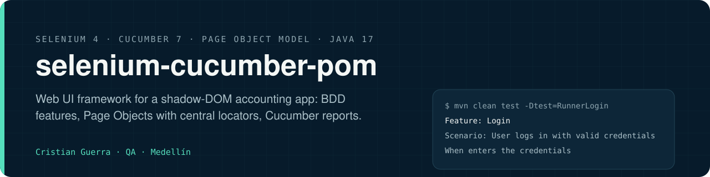
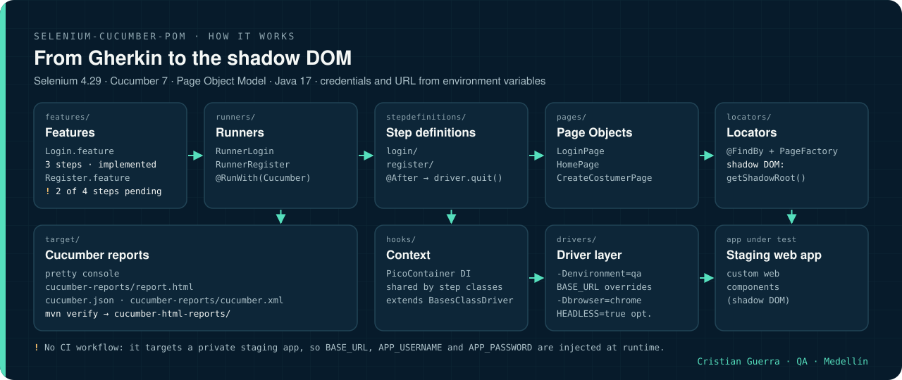

[Leer en español](README.es.md)

<p align="center">
  
</p>

## Explained like you're 8

Imagine a recipe book. Each recipe says in plain words what to do: "open the login page, type your name, check that your name appears". A cook reads each step and does it in the kitchen. In this project the recipes are the feature files, the cook is the Java code, and the kitchen is a web app for accounting. Some of that app's buttons are hidden inside closed boxes (called shadow DOM), so the cook knows a special trick to open them.

### A real example

- **Imagine that:** the recipe "log in" opens the app, types the username and password, and looks at the home page.
- **What should happen:** after logging in, the home page shows the user's name.
- **What the project does:** `LoginPage` types the credentials and `HomePage` checks the name.
- **What we gain:** if logging in broke, the recipe would stop at that step. The second recipe (creating a customer) is only half written: its last two steps are still marked "pending".

<p align="center">
  
</p>

The same animation as [MP4](docs/assets/explained.mp4).

### Hard words

| Word | What it means |
|---|---|
| Selenium | A tool that lets code drive a real web browser |
| Cucumber | The tool that reads plain-English recipes and runs the matching code |
| Page Object | A cheat sheet for one page: where each button is, so the steps don't have to remember |
| Locator | The address of a button or a box on the page |
| Shadow DOM | A closed box inside a page that hides its own buttons |
| Pending | A step that is written down but not programmed yet |

# Selenium Cucumber POM

Web UI automation framework in Java 17 combining Selenium WebDriver 4, Cucumber 7 (BDD) and the Page Object Model, with centralised locators, shadow DOM handling and Cucumber HTML reports.


## How it works

<p align="center">
  
</p>

1. `RunnerLogin` and `RunnerRegister` run one feature each through Cucumber with the `pretty`, HTML, JSON and JUnit plugins.
2. The step definitions receive a shared `Context` from PicoContainer; `Context` extends `BasesClassDriver`, which resolves the URL (`-Denvironment=qa` in `config.properties`, overridable with `BASE_URL`) and starts Chrome.
3. The steps call Page Objects (`LoginPage`, `HomePage`, `CreateCostumerPage`); the locators live in `locators/` as `@FindBy` fields initialised with `PageFactory`.
4. For the app's custom web components, the Page Objects go through `getShadowRoot()` to reach inputs, dropdowns and buttons.
5. In `Register.feature` the last two steps still throw `PendingException`.

<p align="center">
  
</p>

The animation walks the code path of both features step by step (also as [MP4](docs/assets/how-it-works.mp4)). It is not a recording of a run: there is no CI workflow, so no run results are published in this repository.

## What it tests

Written against the staging environment of a cloud accounting web application built with custom web components (shadow DOM). The target URL and credentials are injected at runtime; nothing environment-specific is committed.

| Feature | Scenario | Status |
|---|---|---|
| `Login.feature` | User logs in with valid credentials and lands on the home page (user name is verified) | Implemented |
| `Register.feature` | From the home page open "Create > Customer" and fill in basic data and contact information; submit the form and check the success message | Partially implemented: the last two steps are `PendingException` placeholders |

## Architecture

- **Page Objects** (`pages/`): `LoginPage`, `HomePage` and `CreateCostumerPage` expose user actions; locators live separately in `locators/` as `@FindBy` fields initialised with `PageFactory`.
- **Shadow DOM**: page objects traverse `getShadowRoot()` on custom elements to reach inputs, dropdowns and buttons that regular selectors cannot see.
- **Driver layer** (`drivers/`): `BasesClassDriver` resolves the environment (`-Denvironment=qa` against `config.properties`, overridable with `BASE_URL`) and the browser (`-Dbrowser=chrome`); `MyChromeDriver` builds the `ChromeOptions` (headless with `HEADLESS=true`).
- **Dependency injection**: Cucumber PicoContainer shares a single `Context` (driver and session) across step definition classes.
- **Test data and utilities**: `LoginData` reads credentials from the environment; `RandomFunctions` generates emails, numbers and text; `Waits` wraps explicit waits.

## How to run

Requires JDK 17, Maven 3.x and Google Chrome (the driver is resolved by Selenium Manager).

Configuration comes from environment variables (see `.env.example`): `BASE_URL`, `APP_USERNAME`, `APP_PASSWORD` and the optional `HEADLESS`. The suite fails fast with a clear message if credentials are missing.

```bash
git clone https://github.com/criguex/selenium-cucumber-pom.git
cd selenium-cucumber-pom

export BASE_URL="https://your-app-under-test.example.com/#/login"
export APP_USERNAME="your.user@example.com"
export APP_PASSWORD="your-password"
export HEADLESS=true                        # optional, default false

mvn clean test                              # both runners
mvn clean test -Dtest=RunnerLogin           # single flow
mvn clean verify                            # tests + aggregated HTML report
```

## Project structure

```
.
├── .env.example
├── config.properties
├── docs/
│   ├── assets/        banner.svg, how-it-works.*, explained.* (kids' animation, EN + .es)
│   └── scenes/        how-it-works.html, explained.html + their export scripts
├── pom.xml
└── src/
    ├── main/java/
    │   ├── drivers/      BasesClassDriver, MyChromeDriver
    │   ├── hooks/        Context (shared through PicoContainer)
    │   ├── locators/     LoginLocators, HomeLocators, CreateCostumerLocators
    │   ├── pages/        LoginPage, HomePage, CreateCostumerPage
    │   ├── test_data/    LoginData
    │   └── utils/        Waits, RandomFunctions
    └── test/
        ├── java/
        │   ├── runners/          RunnerLogin, RunnerRegister
        │   └── stepdefinitions/  login/, register/
        └── resources/features/   Login.feature, Register.feature
```

## Reporting

- Cucumber `pretty` console output, HTML report at `target/cucumber-reports/report.html`, JSON at `target/cucumber.json` and JUnit XML at `target/cucumber-reports/cucumber.xml`.
- `mvn verify` runs the `maven-cucumber-reporting` plugin and writes an aggregated report to `target/cucumber-html-reports/`.

## CI

No workflow is configured: the suite targets a private staging environment that needs credentials and a browser, so it runs locally or from a pipeline that injects `BASE_URL`, `APP_USERNAME` and `APP_PASSWORD` as secrets.

## Limits

- `Register.feature` is not finished: its last two steps are `PendingException` placeholders.
- Only Chrome is wired in `BasesClassDriver`; any other `-Dbrowser` value throws `Unsupported browser`.
- Some steps use fixed pauses (`Waits.waitFor`) besides explicit waits.
- The application under test is private, so the suite cannot run without access to that staging environment.

## Rebuilding the animation

`docs/scenes/how-it-works.html` draws each frame from `?t=<seconds>`; `docs/scenes/export.sh` captures the frames with headless Chrome and encodes `how-it-works.gif` and `how-it-works.mp4` with ffmpeg. `docs/scenes/explained.html` (`?t=<seconds>&lang=en|es`) and `docs/scenes/export-explained.sh` do the same for the kids' animation.

---

Cristian Guerra · Senior SDET · [linkedin.com/in/criguex](https://www.linkedin.com/in/criguex)
